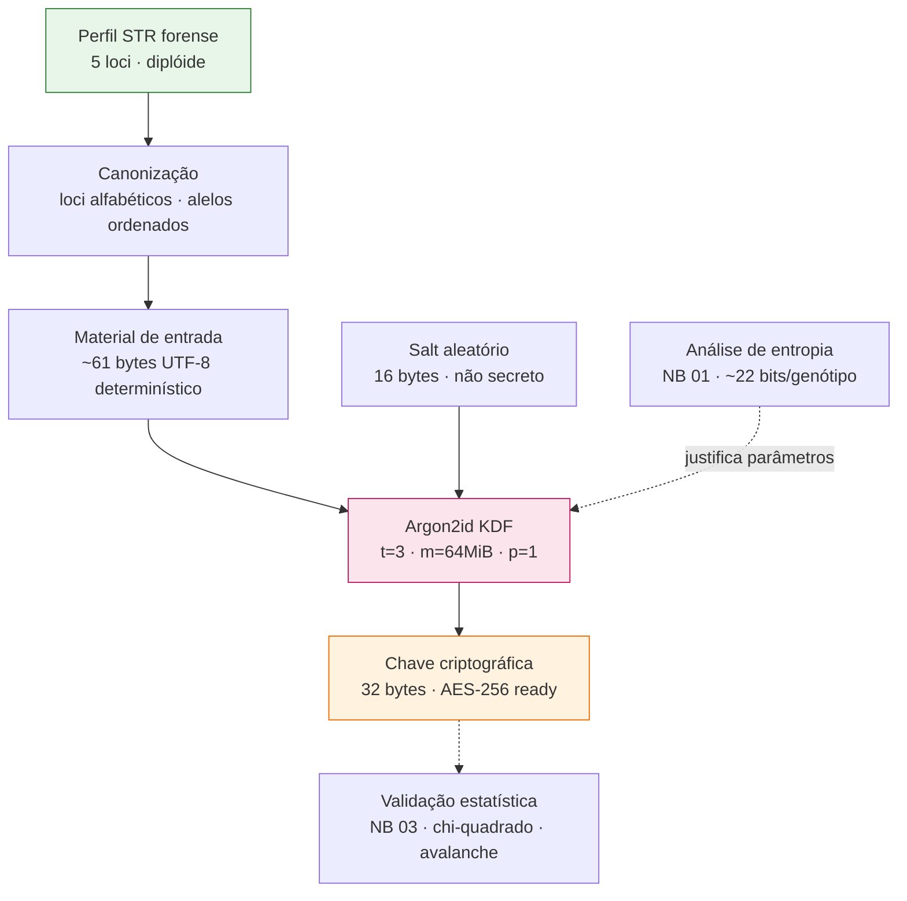

# Fluxograma da Metodologia

Pipeline de geração de chaves criptográficas a partir de perfis STR forenses.

## Legenda do fluxo

| Etapa | Função | Onde está implementada |
|---|---|---|
| Perfil STR | Matéria-prima genética (~22 bits de entropia) | `notebooks/01` |
| Canonização | Serialização determinística sem ambiguidade | `src/derivacao.py` → `perfil_canonico()` |
| Salt | Impede rainbow tables; armazenado junto à chave | `secrets.token_bytes(16)` |
| Argon2id | Estica o custo de força bruta (CPU + memória) | `src/derivacao.py` → `derivar_chave()` |
| Chave 32B | Material pronto para AES-256 | saída `hash_secret_raw` |
| Validação | Uniformidade estatística das chaves em massa | `notebooks/02` (Hamming) · `notebooks/03` (planejado) |

## Parâmetros de segurança (hardware modesto)

- Tempo médio de derivação: **247 ms**
- Custo de memória por tentativa: **64 MiB**
- Implicação: busca exaustiva do espaço de genótipos ≈ **11–12 dias** de CPU serial